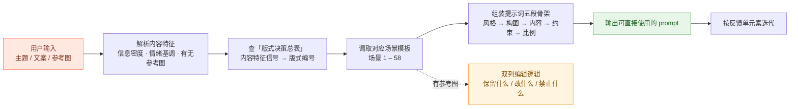
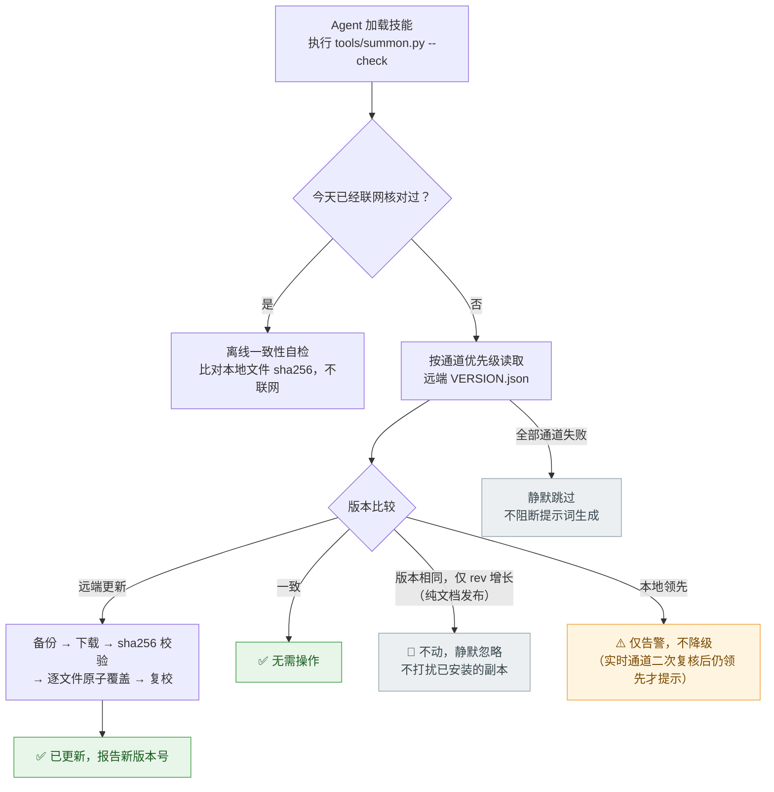
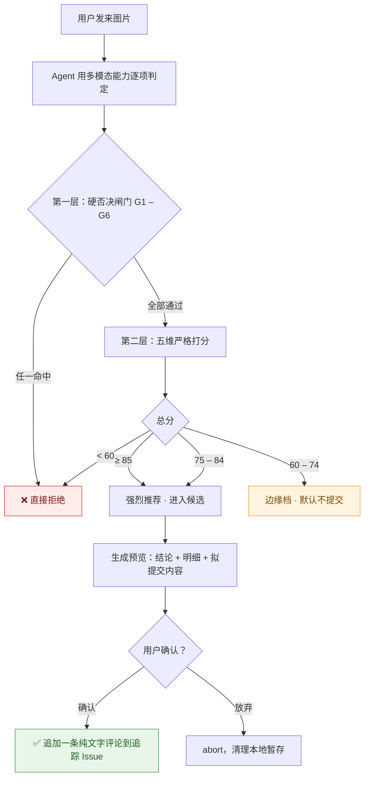

<div align="center">

# GPT-Image-Prompt

**把「挑版式 + 组织生图提示词」变成一次查表。**

输入内容特征 → 自动匹配版式 → 输出可直接使用的结构化提示词

<sub>面向 GPT Image 2 / 2.5 · 标准 <code>SKILL.md</code> 结构 · 任何支持 Skill 机制的 Agent 都能加载</sub>

<br>


-brightgreen?style=flat-square)


</div>

---

## 这是什么

一个**生图提示词决策体系**，以标准 `SKILL.md` 的形式挂载到 Agent 上——**不绑定任何特定平台**，任何支持 Skill 机制的 Agent（Claude Code / WorkBuddy / Cursor 等）都能直接加载。

它不生成图片，也不替代模型。它解决的是写生图提示词时最耗时的两件事——**选什么版式**、**怎么把约束组织清楚**——把这件事从"凭感觉试"变成"查表执行"。

使用者只需要描述内容（或丢一张参考图），Agent 会自动完成：解析特征 → 查版式决策总表 → 调取场景模板 → 组装提示词。

---

## 它解决什么问题

| 没有本技能 | 有本技能 |
|---|---|
| 每次都要想"这张图该用什么结构" | 内容特征直接映射到版式编号 |
| 版式随心情漂移，同一类需求产出的图风格不统一 | 同类需求稳定命中同一模板，产出可预期 |
| 提示词东一句西一句，遗漏约束 | 五段式固定骨架：风格 → 构图 → 内容 → 约束 → 比例 |
| 58 种常见场景要自己踩一遍坑 | 场景模板现成，变量直接替换 |
| 改图时说不清"保留什么/改什么" | 双列编辑逻辑（GPT Image 2.5 双子句定式） |

---

## 快速开始

### 1 · 安装到 Agent 的技能目录

> **技能目录由你所使用的 Agent 决定**——请查阅该 Agent 文档中关于 Skill / 技能目录的约定。
> 下文统一用 `$SKILLS` 指代该目录，先把下面这行改成你的实际路径：

```bash
SKILLS="<你的 Agent 技能目录>"
```

**方式 A — git clone（推荐，便于后续自动更新）**

```bash
git clone https://github.com/HTBjiangnan/gpt-image-prompt.git \
  "$SKILLS/gpt-image-prompt"
```

**方式 B — 下载 ZIP**

在仓库页面点 `Code → Download ZIP`，解压后把整个目录放到：

```
$SKILLS/gpt-image-prompt
```

> 目录名请保持 `gpt-image-prompt`——技能名、版本文件、自更新逻辑都以它为准。

### 2 · 验证安装

```bash
cd "$SKILLS/gpt-image-prompt"
python tools/summon.py --status
```

看到「本地版本 / 仓库 / 凭据 / 远端版本」四行即安装成功。**只读使用不需要任何配置**。

### 3 · 开始使用

直接在对话里提出需求即可，例如"做一张 16:9 的活动海报"、"帮我写个生图 prompt"。
Agent 会先执行启动自检（见下），再按决策体系产出提示词。

---

## 工作原理



**五步固定流程**（Agent 每次都会走）：

1. **解析特征** — 用户给的是什么内容？信息密度高还是低？情绪基调？有没有参考图？
2. **查决策总表** — 内容特征信号直接映射到版式编号（`references/GPT-Image-2-提示词完整指南.md` 第 3 章）
3. **取模板** — 按编号调取场景 1–58 的完整模板（同文件第 4 章）
4. **组装** — 风格定位（开头）→ 构图 → 内容 → 约束 → 比例
5. **迭代** — 用户说"改 XX"时，只动那一个元素，其余保持原文，并输出新旧对比

---

## 给 Agent 的说明（For AI Agents）

如果你是一个正在读取本仓库的 Agent：

| 项 | 值 |
|---|---|
| 技能名 | `gpt-image-prompt` |
| 触发场景 | 用户要生成海报/配图/信息图、要写生图 prompt、要基于参考图改图、要做风格咨询 |
| 第一步 | 执行 `python tools/summon.py --check`（每天第一次会联网核对版本，其余时候离线自检） |
| 核心动作 | **先查版式决策总表，再调模板**，不要直接凭感觉写 prompt |
| 模板库 | `references/GPT-Image-2-提示词完整指南.md`（58 场景 + 决策总表 + 风格关键词 + 参数） |
| 边界 | 不生成图片二进制；图片仅作为评估输入 |

---

## 技能包含什么

```
gpt-image-prompt/
├── SKILL.md                              # 技能主文件：Agent 的调度指令、决策流程、场景速查表
├── VERSION.json                          # 版本权威文件：版本号 + 全部受管文件的 sha256 清单
├── README.md                             # 本文件
├── CHANGELOG.md                          # 人类可读的版本变更记录
├── references/
│   ├── GPT-Image-2-提示词完整指南.md      # 核心模板库：八段式结构 + 版式决策总表 + 58 场景模板
│   └── 收录评估标准.md                    # 候选图片「是否值得收录」的严格评分标准
└── tools/                                # 版本自更新与图片收录工具（纯 Python 标准库，零依赖）
    ├── summon.py                         # 统一 CLI 入口（所有命令都从这里进）
    ├── gh_client.py                      # 网络层：多通道探测、代理自适应、GitHub API 封装
    ├── github_version_check.py           # 版本核对状态机（每日频控 + 缓存复核）
    ├── github_sync.py                    # 下载 / sha256 校验 / 备份 / 原子覆盖 / 回滚 / 反向发布
    ├── image_intake.py                   # 图片收录：指纹去重、闸门校验、两阶段确认、提交
    └── startup_check.py                  # 启动自检报告（版本 / 通道 / 凭据 / 完整性）
```

| 文件 | 角色 | 谁会读它 |
|---|---|---|
| `SKILL.md` | 技能的"大脑"，定义 Agent 何时、按什么顺序做什么 | Agent |
| `references/GPT-Image-2-提示词完整指南.md` | 72 KB 的模板真身，58 场景全文 | Agent |
| `references/收录评估标准.md` | 收录评审的评分细则 | Agent |
| `tools/*.py` | 版本自更新 + 收录提交的可执行部分 | 人 / Agent |
| `VERSION.json` | 版本权威源，自动更新的比对依据 | 工具链 |

---

## 58 个场景模板

完整模板在 `references/GPT-Image-2-提示词完整指南.md`，覆盖：

<details>
<summary><b>展开查看场景分布</b></summary>

| 类别 | 场景编号 | 举例 |
|---|---|---|
| 人物 / 角色 | 1、10、15、17、36 | 写真、二次元、角色拆解设定图、多镜头一致性 |
| 商业海报 | 2、20、21、23、28、41、44、48 | 运营宣传、早安营销、保险主题创意、环形放射信息图 |
| 电商 / 品牌 | 3、12、24、35 | 商品图、品牌视觉系统、高级静物、Logo |
| 数据 / 信息图 | 5、18、39、40、42、51 | 知识科普、GIS 地图、流程可视化、成本公示页 |
| 长图 / 卷轴 | 7、53、54、58 | 文档解读、长卷贯穿、双面对开、横向山水卷轴 |
| 社交 / 内容 | 26、27、33、34、37 | 小红书系列、连续性漫画、社媒截图、缩略图、四格 |
| 版式实验 | 29、30、43、45、46、47、49、52、55、56、57 | 偷拍感、破框而出、胶囊卡、模块化拼图 |
| 编辑逻辑 | 38 | 图像编辑双列逻辑（改什么/保留什么/禁止什么） |

</details>

指南另含：八段式结构说明、版式决策总表、风格关键词库、通用参数、实拍照片 12 玩法、GPT Image 2.5 补充规则。

---

## 版本自更新

技能本体在本仓库维护，**以远端为最新权威源**。任何装了这个技能的电脑，加载时会先做一次启动自检。



### 版本号是怎么定的（为什么改个 README 不会打扰别人）

`VERSION.json` 里有两个版本概念，职责严格分开：

| 字段 | 含义 | 什么时候变 |
|---|---|---|
| **`version`** | 语义版本，**自动更新的唯一依据** | **只有技能文件**（`SKILL.md` / `references/**` / `tools/**`）变化才递增 |
| `rev` | 修订号，每次发布 +1 | **任何**改动都 +1（含纯文档），只用于审计与提示 |
| `release` | 本次发布类型 | `skill`（技能更新）/ `docs`（仅文档） |

按这个规则，文件被分成两类：

| 类别 | 包含 | 改动后果 |
|---|---|---|
| **行为文件** | `SKILL.md`、`references/**`、`tools/**` | 递增 `version` → **其他电脑下次加载时自动更新** |
| **文档文件** | `README.md`、`CHANGELOG.md`、`LICENSE`、`.gitignore` | **不递增 `version`** → 其他电脑**完全不动作** |

发布时（`--push`）会**自动比对远端清单**判定类别，不需要人工声明：

- 行为文件有差异 → 版本号自动 patch +1（想要 minor 用 `--set-version` 显式指定）
- 只有文档差异 → 版本号保持不变，只 `rev` +1
- 版本号相同但行为文件仍不一致（发布方漏升版的异常）→ 核对方会**保守按远端同步**，不会长期漂移
- 想连文档也一起同步到本机：`--update --sync-docs`

### 多通道降级

网络环境千差万别，工具不会假设任何单一通道可用。下表优先级的**实测耗时**来自真实网络（不同环境会有差异，但相对关系通常一致）：

| 优先级 | 通道 | 单文件实测 | 说明 |
|---|---|---|---|
| 1 | `api.github.com` | ~0.6 s | 实时无缓存；匿名限流 60 次/小时（本技能每天仅用 1–2 次） |
| 2 | `codeload.github.com` | ~0.8 s | 一次拉整包 tarball，实时 |
| 3 | `raw.githubusercontent.com` | 16 – 50 s | 部分网络下极慢且抖动，仅作兜底；已单独限制 8 s 超时 |
| 4 | `cdn.jsdelivr.net` | ~4 s | CDN 缓存约 12 小时，放最后以免误导版本判定 |

- 任一通道成功即用，结果缓存 30 分钟
- **自动绕开失效的环境代理**：先探测 `http_proxy` / `https_proxy` 指向的端口是否存活，死了就直连
- 需要拉取多个文件时（即自动更新场景），**优先一次拉整包**——逐个文件走通道会放大网络抖动
  （实测：13 个文件逐个下载累计 > 100 秒，整包只需 0.8 秒，整次更新约 3 秒完成）
- 判定"本地领先"前会用**实时通道复核一次**（单通道不降级），避免 CDN 缓存造成的误报

### 安全策略

| 场景 | 动作 |
|---|---|
| 远端更新 | 自动下载覆盖（先备份 → sha256 校验 → 原子替换 → 复校） |
| 版本一致 | 不动 |
| **远端只有文档更新**（`version` 相同、仅 `rev` 增长） | **不动**（不影响技能行为）；要同步用 `--update --sync-docs` |
| **本地领先** | **只告警，绝不自动降级**（避免抹掉本机未发布的改动） |
| 校验失败 / 覆盖出错 | 自动从备份还原，并报告失败原因 |
| 新版本移除了某些文件 | 自动清理（仅限**旧清单里登记过的**受管文件） |
| 你自己往技能目录里放的文件 | **不会被删**（不在清单里就永远不动） |
| 全部通道不可用 | 静默跳过，不影响技能主功能 |

**数据目录**（与 Agent 平台无关，可用环境变量 `GPT_IMAGE_PROMPT_HOME` 覆盖）：

| 内容 | 默认位置 |
|---|---|
| PAT 配置 | `~/.gpt-image-prompt/config.json` |
| 更新备份（保留最近 10 份） | `~/.gpt-image-prompt/backups/<时间戳>/` |
| 每日核对打卡 | `~/.gpt-image-prompt/check_stamp.json` |
| 审计日志 | `~/.gpt-image-prompt/audit.jsonl` |

> 数据目录与 Agent 平台**完全无关**：无论装到哪个 Agent 的技能目录下，配置、备份、日志都只写这里，不会往 Agent 自己的目录里塞东西。

更新只会触碰技能目录内的文件，**绝不递归删除、绝不触碰技能目录之外的任何路径**。

### 命令一览

```bash
python tools/summon.py --check              # 比对版本（每天第一次联网，其余离线自检）
python tools/summon.py --check --force-check  # 忽略每日限制，立即联网核对
python tools/summon.py --update             # 立即核对并自动更新
python tools/summon.py --update --sync-docs  # 连纯文档变更也一起同步
python tools/summon.py --status             # 版本 / 修订 / 通道 / 配置状态
python tools/summon.py --status --probe-channels  # 附带通道探测
python tools/summon.py --probe              # 只探测各通道连通性
python tools/summon.py --audit              # 公开前自检（扫令牌/绝对路径/内网地址/敏感词）
python tools/summon.py --push -m "message"  # 反向发布本机技能到 GitHub（需 PAT）
python tools/summon.py --intake list        # 查看待确认的收录候选
python tools/summon.py --help               # 完整帮助
```

### 返回码

| 码 | 含义 |
|---|---|
| `0` | 一致 / 成功（含「远端只有文档构建更新」，不更新） |
| `10` | 本地落后（已更新 或 提示可更新） |
| `11` | 本地领先（只告警，未改动） |
| `20` | 网络不可用 |
| `30` | 配置缺失（如未配 PAT 却要发布） |
| `40` | 审计命中 / 敏感内容否决 |
| `2` / `3` | 收录评估：待确认 / 重复图片 |

---

## 图片收录评估（可选功能）

把生成的图片交给技能，它会按严格标准判断这张图**是否值得沉淀为新模板**，通过则提交为候选，由维护者决定是否收录。

> **提交内容只有文字**——评分明细、判定、拟新增模板骨架。本技能的沉淀物是文字模板，图片只是评估输入，因此**不向仓库提交图片二进制**，仓库体积零增长，也不依赖任何图床。



### 第一层 · 硬否决闸门（一票否决）

| 编号 | 否决条件 |
|---|---|
| G1 | 含敏感数据（客户身份信息、经营数据、内网地址、密钥等） |
| G2 | **中文文字渲染有错（错字 / 缺字 / 乱码 / 字形崩坏）—— 零容忍** |
| G3 | 画面有硬伤（结构畸变、透视错乱、比例失真、物件崩坏） |
| G4 | 无法抽象为可复用的参数化模板 |
| G5 | 已被现有 58 场景覆盖且无实质改进 |
| G6 | 超出技能定位（不属于生图提示词范畴） |

每条否决**必须给出具体证据**（如"第 2 行某字误作另一字"），只给结论不给证据视为无效。

### 第二层 · 严格打分（仅通过闸门者进入）

| 维度 | 权重 |
|---|---|
| 版式新颖度 | 30 |
| 模板可复用性 | 25 |
| 视觉质量 | 20 |
| 差异化参照价值 | 15 |
| 业务场景覆盖度 | 10 |

**硬性附加**：必须同时给出 ① 对标的现有场景（编号 + 标题）② 差距 / 改进点 ③ 拟新增模板（拟编号 + 标题 + 归入章节）。
**给不出 ③ 即按 G4 否决。**

### 判定阈值

| 总分 | 档位 | 动作 |
|---|---|---|
| ≥ 85 | 强烈推荐 | 进入提交候选 |
| 75 – 84 | 值得收录 | 进入提交候选 |
| 60 – 74 | 边缘 | **默认不提交**，除非显式要求强制提交 |
| < 60 | 不收录 | 拒绝，仅记本地审计 |

> 设计意图就是**宁缺毋滥**——预期绝大多数图片不通过，这是正常现象。

### 使用

```bash
python tools/summon.py --intake stage <图片路径> <评估JSON>   # 第一阶段：评分 + 暂存 + 出预览
python tools/summon.py --intake list                          # 查看待确认候选
python tools/summon.py --intake commit <stage_id> --confirm   # 第二阶段：用户确认后提交
python tools/summon.py --intake abort <stage_id>              # 放弃
```

提交需要 PAT 写入权限；未配置时自动降级为只读，只输出评估结论。
同一张图（按字节 sha256 指纹）不会重复提交。

---

## 如何把已安装的副本更新到最新版本

> 这是最常见的疑问：**我的电脑上已经有这个技能了，怎么拿到最新版？**
>
> 先给结论——**什么都不用做。** 副本自带更新能力，会自己升到最新。

### 自动更新（默认行为，无需干预）

技能在下一次被 Agent 加载时会自动检查并更新：

1. Agent 进入技能 → 按 `SKILL.md` 的「零、启动自检」执行 `--check`
2. **每天第一次**加载时联网，把本地版本与远端 `VERSION.json` 比对
3. 远端更新 → 自动备份并覆盖 → 报告新版本号；一致 → 静默通过
4. 当日后续加载不再联网，只做离线一致性自检（不卡顿）

**什么**不会**触发自动更新**：如果某次发布只改了 README / CHANGELOG 这类文档，发布方**不升版本号**
（只 +1 一个内部修订号 `rev`）。想主动同步这类文档改动，用 `--update --sync-docs`。

> 一次更新通常 **3 秒左右**完成（一次拉整包 → sha256 校验 → 备份 → 原子覆盖 → 复校）。
> 如果本地已是最新，则**完全不写磁盘**。

### 手动更新（想立刻拿到新版，不想等下次加载）

```bash
cd "$SKILLS/gpt-image-prompt"

# 只看有没有新版（忽略"每天一次"限制，立即联网）
python tools/summon.py --check --force-check

# 直接更新
python tools/summon.py --update

# 确认结果：本地版本 / 远端版本 两行应当一致
python tools/summon.py --status
```

更新出问题时，把备份里的文件拷回技能目录即可还原（保留最近 10 份）：

```
~/.gpt-image-prompt/backups/<时间戳>/
```

### 换新电脑，第一次安装

直接 clone 或下载 ZIP 即可，**不需要任何配置**（公开仓库只读免鉴权）：

```bash
git clone https://github.com/HTBjiangnan/gpt-image-prompt.git \
  "$SKILLS/gpt-image-prompt"
```

装完即进入上面的「自动更新」轨道。

### 多台电脑怎么保持同步

| 场景 | 做法 |
|---|---|
| 只是想用最新版 | 每台机各装一份，靠自动更新保持一致，无需人工干预 |
| 想在其他电脑上改这个技能 | 需要在该机配置 PAT（写入 `~/.gpt-image-prompt/config.json`，**位于技能目录之外**），改完跑 `python tools/summon.py --push` |
| 别人想用 | 直接 clone 本仓库，读权限完全公开 |

> ⚠️ 配置文件 `~/.gpt-image-prompt/config.json` **不在技能目录内**，因此永远不会随技能被同步出去，token 不会泄露。没有这个文件的电脑就是纯只读模式，一切正常。

---

## 常见问题

<details>
<summary><b>Q：需要联网才能用吗？</b></summary>

只有**每天第一次**加载时会联网核对版本，通常几百毫秒完成。日内再次使用完全离线，不会卡顿。网络全不通时也只是跳过核对，提示词生成不受任何影响。
</details>

<details>
<summary><b>Q：需要 GitHub 账号或令牌吗？</b></summary>

**只读使用完全不需要**——仓库是公开的，clone、下载、版本核对全部免鉴权。
只有"提交收录候选"或"反向发布（push）"才需要 PAT。
</details>

<details>
<summary><b>Q：自动更新会不会覆盖我本地的改动？</b></summary>

不会。策略是**只升不降**：

- 远端版本更高 → 覆盖前**整目录备份**，逐文件原子替换，失败自动回滚
- 本地版本更高（说明你改过但没发布）→ **只告警，绝不动文件**
- 版本一致 → 不写入

备份保留最近 10 份，随时可手工还原。
</details>

<details>
<summary><b>Q：中间隔了很久没联网，会不会错过更新？</b></summary>

不会。判定依据是**版本号比较**而不是时间差。隔几个月再联网，一样会比对到最新版本并一次升到位。
</details>

<details>
<summary><b>Q：为什么"本地领先"只是告警不自动降级？</b></summary>

因为"以远端为权威"如果无条件执行，会在你本机改了技能但还没发布时，把本地工作直接抹掉。所以遇到这种情况工具交回决定权给你，需要强制同步时再手动处理。
</details>

<details>
<summary><b>Q：收录评估为什么这么严？</b></summary>

模板库是要长期复用的资产，公开仓库里的每条记录都会被别人读到。放低标准的代价是库被稀释——所以设了硬否决闸门（尤其是**中文错字零容忍**）+ 高分阈值，宁可漏收，不可错收。
</details>

<details>
<summary><b>Q：支持哪些模型？</b></summary>

主要面向 **GPT Image 2 / 2.5**，模板里含 2.5 的专属补充规则。但提示词结构本身（风格 → 构图 → 内容 → 约束 → 比例）对多数生图模型通用。
</details>

---

## 许可

未授予开源许可，保留所有权利。仓库可自由浏览与下载，如需使用请先联系作者。

---

<div align="center">
<sub>本技能由 GitHub 仓库作为版本权威源 · 每次加载自动核对 · 只升不降 · 覆盖前备份</sub>
</div>
